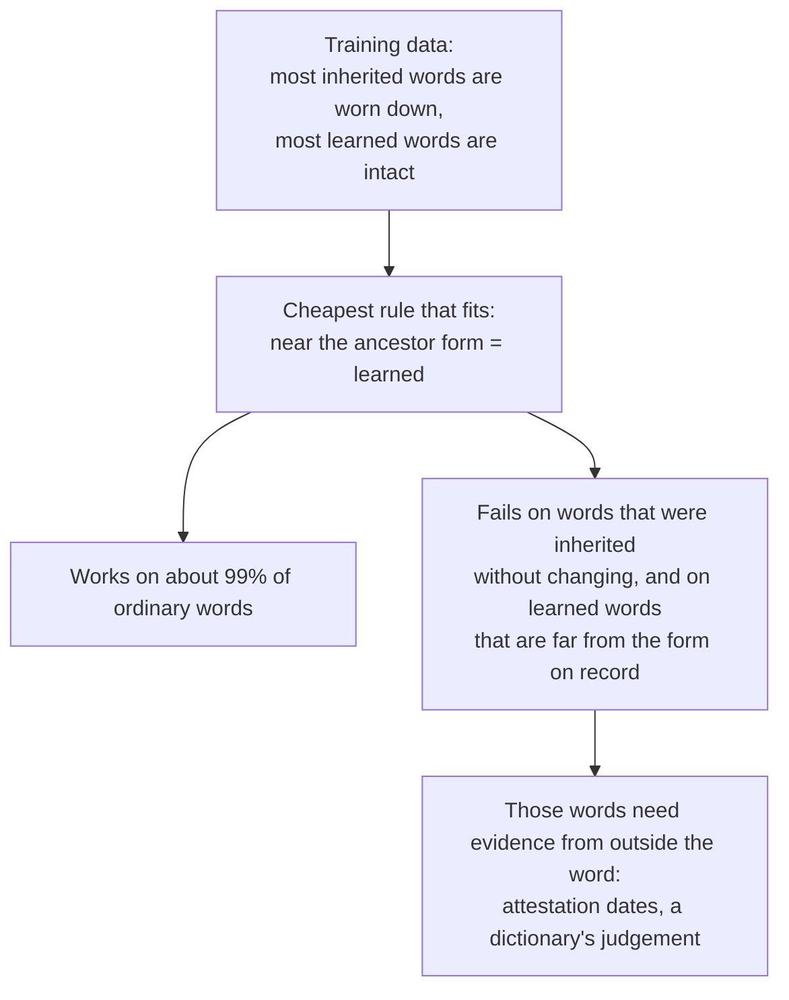
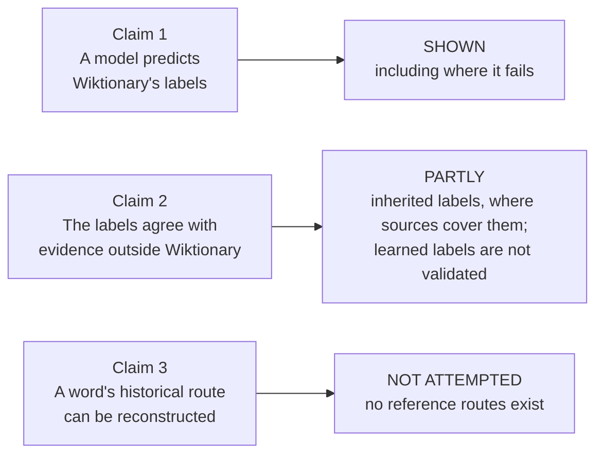
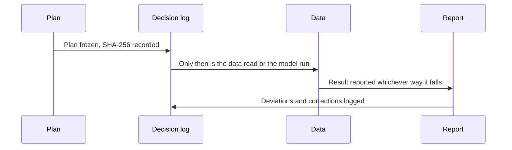

# What Form Cannot Tell

**Do models trained on Wiktionary's "inherited" and "learned" labels learn word history, or only resemblance?**
An audit of the labels in 17 languages, a form-based baseline, and a set of checks on the words where the label and the resemblance disagree.

| | |
|---|---|
| Paper | `paper/main.pdf` (15 pages; main text 8). Submission copy and anonymous supplementary page: `submission/` |
| Every decision, in order | `docs/decision_log.md` |
| Every analysis report | `docs/supplementary_report.md`, `docs/crosslingual_audit_report.md`, `docs/baseline_report.md`, `docs/feasibility_report.md` |
| Status, 2026-10-13 | All planned analyses are run, including a pretrained model. No human expert has labelled the project's own items |

---

<p align="center"></p>

**In sixty seconds**

1. Wiktionary says, for tens of thousands of words, whether a word was *inherited* from the ancestor language or *borrowed back* from it later.
2. A simple model predicts that label very well from the spelling alone.
3. It does so by measuring **resemblance**: close to the old form means "learned", far means "inherited". That is not a trick. It is the textbook test for a learned word, because a learned word skipped the sound changes.
4. The test has a blind spot. Some words were inherited without changing, and some learned words sit far from the form on record. On those words (the red cells above) the model is wrong almost every time.
5. Nothing we tried sees into the blind spot: not the intermediate form, not a Transformer, not a pretrained model, not word meaning, not a dictionary record. The best combination only matches a blind guess of the commoner label.
6. So a high score on these labels shows agreement with Wiktionary. It does not show that a model has learned word history. For the hard words, history is a matter of record, not of form.

**Why it matters outside etymology.** Labels from collaborative resources are cheap and widely used. This study is a worked example of how to ask what a score on such labels measures: audit how the labels are recorded, find the cue a model uses, isolate the items where cue and label disagree, check those against outside evidence, and read the history of the labels.

---

## 1. The question

Many languages have two kinds of words from the same ancestor language.

| Kind | What happened | What it tends to look like |
|---|---|---|
| **Inherited** (*tadbhava*) | Passed down over many centuries, changing its sounds on the way | Worn down; often far from the old form |
| **Learned** (*tatsama*) | Borrowed later, straight from the old language's books | Still close to the old form |
| **Semi-learned** | Borrowed later, then partly adapted | In between |

Wiktionary labels tens of thousands of words this way, and such labels have been used to train classifiers. A high score on them can mean two different things:

<p align="center"></p>

### Four real Hindi words

These are items from the data, with the ancestor form as our reader normalised it. Distance runs from 0 (same spelling) to 1.

| Word | Sanskrit form | Distance | Wiktionary says | Model says | |
|---|---|---|---|---|---|
| पात (its inherited sense) | पत्त्र | 0.67 | inherited | inherited | right: far, so "inherited" |
| भवन | भवन | 0.00 | learned | learned | right: identical, so "learned" |
| जल | जल | 0.00 | **inherited** | learned | **wrong**: identical, but Wiktionary says it was inherited |
| छंद | छन्दस् | 0.67 | **learned** | inherited | **wrong**: far, but Wiktionary says it was borrowed |

The last two rows are the *dissociated* items. Nothing in the spelling of जल tells you whether it came down through Prakrit unchanged or was taken from Sanskrit books. That is a fact about records, not about letters.

<details>
<summary><b>Why does the model fail on exactly these words?</b></summary>

The model learns the rule that fits most of its training data. That rule is right for ordinary words and has nothing to say about the exceptions.



</details>

<details>
<summary><b>What do "congruent" and "dissociated" mean?</b></summary>

- **Congruent:** the label agrees with resemblance. Inherited and far from the ancestor form (distance at least 0.5), or learned and near it (at most 0.15).
- **Dissociated:** the reverse. Inherited but near, or learned but far.
- Words in between are left out of this split.
- The split is a **diagnostic**: it is built from the label and a distance, so it shows where a model leans on resemblance. It is not an independent test set, and the labels in it have not been checked by a person.
- Because the split uses the model's own feature, the low score on it is **partly by construction**. The informative comparisons are with a model that sees only the word, and with the majority rate (how often you are right if you always guess the commoner label).

</details>

## 2. The study in one picture

<p align="center"></p>

## 3. Results

| # | Finding | Key numbers | Report |
|---|---|---|---|
| 1 | The labels are tidy but rarely cite a source | A learned-borrowing claim has its own citation in at most 4% of senses in 16 of 17 languages; the semi-learned class never exceeds 129 pages | `docs/crosslingual_audit_report.md` |
| 2 | Form predicts the label | Macro-F1 0.86 to 0.96 (Sanskrit family), 0.75 to 0.91 (Romance), 0.62 and 0.59 (Greek, Armenian) | `docs/baseline_report.md` |
| 3 | The models fail where label and resemblance disagree | Right on 27 of 260 (10%) and 52 of 272 (19%) dissociated items. A model that sees only the word is right on 54% and 74%. The result holds for all 15 pairs of thresholds tried | `docs/supplementary_report.md` S2; `docs/supplementary_plan_s13.md` |
| 4 | Those labels follow a dictionary | Turner lists a matching form for 57 of 125 near-Sanskrit words called inherited (46%) and 100 of 1,001 called learned (10%) | S7a |
| 5 | The intermediate stage explains the failure and does not repair it | A rule with no training agrees with the label on 1,484 of 1,864 items (80%) where the intermediate form changed; for 92 of 110 hard inherited items (84%) it did not change | S8 |
| 6 | Expert sources agree with Wiktionary's inherited labels | Not loans: 651 of 684 Romanian words, 277 of 291 in thirteen languages; on 48 hard items the specialists side with Wiktionary on 45, the model on 22 | S6, S9 |
| 7 | Most Romance learned labels are recent, and one bot set them | In October 2024, 258 of 370 sampled ones were plain "borrowed from Latin"; inherited labels changed in 4 of 873. Of 252 dated changes, 241 were made in September 2026 and 240 by one account in the bot group | S1; `docs/supplementary_plan_s15.md` |
| 9 | The collapse on the hard items can be avoided; the ceiling cannot | Training weights, word meaning and a dictionary record lift the linear model from 10% to 53% (Sanskrit family) and from 19% to 44% (Romance). The majority rates are 54% and 67% | `docs/supplementary_plan_s14.md` |
| 8 | Dictionaries cannot settle the hard Hindi and Bengali cases | A route could be assigned to 26 of 58 senses, and to none of the 12 semi-learned ones | `docs/feasibility_report.md` |

<p align="center"></p>

**The three-input experiment** (3,289 Indo-Aryan items, pooled folds grouped by ancestor form). Of the 194 hard items, 110 are labelled inherited, so always guessing "inherited" is right on 57%.

| Model | Input | Macro-F1 | Hard items right (of 194) | Balanced accuracy on hard items |
|---|---|---|---|---|
| Logistic regression | Word only | 0.78 | 113 (58%) | 57% |
| | Word + ancestor form | 0.90 | 11 (6%) | 6% |
| | Word + ancestor + intermediate form | 0.90 | 12 (6%) | 7% |
| Character Transformer | Word only | 0.78 | 123 (63%) | 64% |
| | Word + ancestor form | 0.86 | 91 (47%) | 48% |
| | Word + ancestor + intermediate form | 0.86 | 95 (49%) | 50% |
| Pretrained character model (CANINE-S) | Word only | 0.76 | 115 (59%) | 59% |
| | Word + ancestor form | 0.84 | 109 (56%) | 58% |
| | Word + ancestor + intermediate form | 0.85 | 98 (51%) | 52% |

The ancestor form buys the overall score at the cost of the hard items, and the intermediate form restores nothing, in any of the three models. (With folds made per language, the logistic counts are 120, 15 and 23.)

<p align="center"></p>

The chart shows the first two models; the pretrained model's figures are in the table.

<details>
<summary><b>How to read this chart</b></summary>

- **Word only:** the models are at or a little above the majority rate (57%). They cannot measure resemblance, so they cannot be misled by it.
- **Word + ancestor form:** the logistic model now measures resemblance directly and drops to 6%. Its overall score rises from 0.78 to 0.90 at the same time. The Transformer follows resemblance less closely, scores lower overall, and sits below the majority rate.
- **+ intermediate form:** no real change in any model. For 84% of the hard inherited words the intermediate form is itself almost the Sanskrit form, so it carries nothing to learn from.

</details>

<p align="center"></p>

<details>
<summary><b>How to read this chart</b></summary>

- Inherited labels hardly move.
- Most Romance "learned" labels were plain "borrowed from Latin" two years ago: 258 of the 259 changes are that refinement, not a reversal.
- We then dated the changes. Of 252 Romance changes, 241 fall in September 2026 and 240 were made by one automated account. The template for learned borrowings has existed since 2015, so this is not the arrival of a new tool.
- We do not know the rule that account applied. If it relabelled every borrowing from Latin, the Romance "learned" class is that class under a new name.
- A stable label is not a correct label.

</details>

**What does help, and how far** (linear model, Sanskrit family, 260 hard items, majority rate 54%):

| Given to the model | Hard items right | Macro-F1 |
|---|---|---|
| Form only | 27 (10%) | 0.912 |
| + dictionary record | 66 (25%) | 0.919 |
| + training weights | 106 (41%) | 0.895 |
| + weights, meaning and record | 138 (53%) | 0.890 |
| Word alone, no ancestor form | 140 (54%) | 0.804 |

Weighting the training items so that the distance cannot carry the label alone removes most of the collapse. Nothing passes the majority rate.

**Null results, reported as such:** two local language models (Gemma 3, 4 and 12 billion parameters) answered "inherited" whatever the word; hard items were not edited more often than easy ones.

### Questions a reader usually asks

<details>
<summary><b>Is the model wrong, or is Wiktionary wrong?</b></summary>

We cannot say in general, and the paper does not claim to. What we can say: where a comparative dictionary covers the hard words, Wiktionary's label goes with the dictionary and not with resemblance (46% against 10%). Two expert sources agree with Wiktionary on 45 of 48 hard items of basic vocabulary. That check has little power, because about 95% of inherited-category words in those sources are non-loans whatever their form.

</details>

<details>
<summary><b>Why not use a bigger model?</b></summary>

We tried three: a linear model, a Transformer trained from scratch and a pretrained character model. For a word like जल, the Hindi form, the Sanskrit form and the Prakrit form are all the same string. No model can read a difference that is not in its input.

</details>

<details>
<summary><b>What would settle the hard cases?</b></summary>

Evidence from outside the word: when it is first attested, in what kind of text, and what a historical dictionary or grammar says. We tested whether four dictionaries can supply this for 48 Hindi and Bengali words. They gave a route for 26 of 58 senses and for none of the 12 semi-learned ones.

</details>

<details>
<summary><b>I train or evaluate on these labels. What should I do?</b></summary>

1. Report the score on the hard items separately, beside the majority rate and a word-only model.
2. Say whether you measure agreement with Wiktionary or agreement with independent evidence.
3. Read the route per sense from the etymology section. Up to 17.5% of titles carry more than one.
4. Weight training items by route and distance band if you want a model that does not collapse on the hard items.

</details>

## 4. What is shown and what is not



- **No human expert has labelled the project's own items.** Blank blind sheets for the hard items are ready in `data/annotation/expert_kit_v2/`. The sheets in `data/annotation/expert_kit/` were filled by a language model in two passes; they are not expert annotation and nothing from them is in the paper (see the note in that folder and the spot check in `data/annotation/spot_check_entry_numbers_2026-10-13.csv`).
- **The dictionary lookups for the 48 words were made by an AI assistant.** A person compared 23 of the 134 source records with the dictionaries.
- **The hard subset is a diagnostic split**, defined from the label and a distance. It is not an independent test set, and the low score on it is partly by construction.
- **The pretrained model's per-item predictions are not stored.** Its figures come from the printed summary of the run, checked against the saved notebook (`data/audit/s12_v1/`).
- **Two defects were found late and corrected.** The template reader took a transliteration parameter for the ancestor form in 21 items, and four analyses attached items to their subset by spelling. Both were fixed and everything built on the baseline was rerun into `v2` folders; the first-run files are kept beside them (decision log, entries 110, 114 and 116). Not redone: the language-model check and the annotation sheets.

## 5. How the work was kept honest



- **Plans frozen before outcomes.** Each analysis has a plan file in `docs/` whose hash is in the decision log.
- **Mistakes are recorded.** A reader defect in the first audit run, a wrong citation count and a transliteration bug were each corrected and logged.
- **Sites' access rules were respected.** Two dictionaries that forbid automated reading were not used.
- **Copyrighted dictionary text is never stored**, only entry references and paraphrases.
- **Model output is never used as a label.**

## 6. Reproduce

**Set up** (Python 3.13):
```
uv venv .venv && uv pip install --python .venv/bin/python -r requirements.txt
```

**Tests:**
```
.venv/bin/python tests/test_audit_fixture.py
.venv/bin/python tests/test_baseline_helpers.py
.venv/bin/python scripts/annotation_agreement.py --self-test
```

**Offline analyses.** These read only files in this repository. Rerun on 2026-10-12, they gave output identical to the committed result files, except the order of two tied rows in `references.csv`.
```
R=data/raw/wiktionary/crosslingual_v1
.venv/bin/python scripts/audit_crosslingual.py      $R out/audit
.venv/bin/python scripts/baseline.py                $R out/baseline
.venv/bin/python scripts/baseline_supplementary.py  $R out/baseline
.venv/bin/python scripts/history_analysis.py        $R data/raw/wiktionary/history_v1 out/history
.venv/bin/python scripts/s8b_recorded_links.py      $R out/s8b
```

**Analyses that need a temporary copy of the Jambu database** (S4, S7a, S8a, S8c, S10, S11). Jambu's copy of Turner's dictionary has no licence, so it is not stored here: download it to a temporary folder, run, and delete it.
```
T=$(mktemp -d)
curl -sL -o $T/forms.csv https://media.githubusercontent.com/media/moli-mandala/data/main/cldf/forms.csv
curl -sL -o $T/edges.csv https://raw.githubusercontent.com/moli-mandala/data/main/cldf/edges.csv
.venv/bin/python scripts/s8a_missing_link.py     $T/forms.csv $T/edges.csv data/baseline_v2 out/s8
.venv/bin/python scripts/s10_three_conditions.py $T/forms.csv $T/edges.csv data/baseline_v2 out/s10
rm -rf $T
```

**The Transformer** (S11; about 30 minutes on a laptop GPU, PyTorch 2.14.1). Results vary slightly by device.
```
uv pip install --python .venv/bin/python -r requirements-neural.txt
.venv/bin/python scripts/s11_transformer.py $T/forms.csv $T/edges.csv data/baseline_v2 out/s11
```

**Recounts and extra conditions on the stored predictions** (no download):
```
.venv/bin/python scripts/s13_threshold_sensitivity.py data/baseline_v2
.venv/bin/python scripts/s14_beyond_form.py $R data/baseline_v2 data/audit/turner_scale_v2/item_flags.csv.gz
```
The second command needs the Turner flag file, which is kept locally and not published.

**The pretrained model** (S12): import `docs/s12_kaggle_notebook.ipynb` on a hosted GPU and run all cells. Use "Save & Run All" so that the output files are kept.

**The charts in this file:** `.venv/bin/python scripts/make_readme_figures.py .`

**The supplementary page:** `.venv/bin/python scripts/make_supplementary_site.py . submission/index.html`

**The paper:** `cd paper && tectonic main.tex`

**Not needed to reproduce:** the fetch scripts (`scripts/fetch_*.py`). The retrieved pages are stored with their revision IDs under `data/raw/wiktionary/`.

## 7. Repository map

| Path | What is there |
|---|---|
| `paper/` | LaTeX source, bibliography, PDF |
| `submission/` | The PDF as submitted, an Overleaf-ready zip, the anonymous supplementary page and its guide, and a compliance report |
| `scripts/` | One script per analysis; the first line of each gives its plan and usage |
| `tests/` | Hand-worked test cases for the template reader and the distance |
| `docs/` | Frozen plans, reports, protocols, decision log |
| `data/raw/wiktionary/` | Retrieved pages and past revisions, with revision IDs |
| `data/audit/`, `data/baseline_v2/` | Result files |
| `data/annotation/` | The 48-word dictionary study, blank expert sheets (`expert_kit_v2/`) and model-filled sheets (`expert_kit/`) |
| `data/external/` | Rows used from two open expert databases, with attribution |
| `data/release/` | Draft benchmark file, data sheet and licensing review (not published) |
| `archive/` | Superseded drafts and plans, kept and never deleted |

## 8. Where every number comes from

Folders ending in `_v2` hold the corrected run that the paper reports; the matching `_v1` folders hold the first run and are kept for the record.

| Paper section | Result files | Script | Frozen plan |
|---|---|---|---|
| Audit | `data/audit/crosslingual_v1/measures.csv`, `tables.md` | `scripts/audit_crosslingual.py` | `docs/crosslingual_audit_plan.md` |
| Baseline | `data/baseline_v2/a1_cv.csv`, `a2_semi.csv`, `a3_transfer.csv`, `leakage_check.csv` | `scripts/baseline.py`, `scripts/baseline_leakage_check.py` | `docs/baseline_plan.md` |
| Dissociation, citation | `data/baseline_v2/s2_dissociation.csv`, `s3_citation.csv`, `oof_predictions.csv.gz` | `scripts/baseline_supplementary.py` | `docs/supplementary_plan.md` |
| Turner at scale | `data/audit/turner_scale_v2/` | `scripts/turner_scale.py` | `docs/supplementary_plan_s4.md` |
| Dictionary on the hard items | `data/audit/s7_v2/` | `scripts/s7a_turner_by_subset.py`, `scripts/s7b_history_by_subset.py` | `docs/supplementary_plan_s7.md` |
| The missing link | `data/audit/s8_v2/` | `scripts/s8a_missing_link.py`, `scripts/s8b_recorded_links.py` | `docs/supplementary_plan_s8.md` |
| Language model | `data/llm_s5/` | `scripts/llm_dissociation.py` | `docs/supplementary_plan_s5.md` |
| Language model, larger | `data/llm_s5b/` | `scripts/llm_dissociation.py`, `scripts/llm_by_route.py` | `docs/supplementary_plan_s5b.md` |
| Expert check, thirteen languages | `data/audit/iecor_v2/`, `data/external/iecor/` | `scripts/iecor_expert.py` | `docs/supplementary_plan_s9.md` |
| Three input conditions, grouped folds | `data/audit/s10_v2/` | `scripts/s10_three_conditions.py` | `docs/supplementary_plan_s10.md` |
| The same with a character Transformer (needs PyTorch) | `data/audit/s11_v2/` | `scripts/s11_transformer.py` | `docs/supplementary_plan_s11.md` |
| Pretrained character model on the three inputs | `data/audit/s12_v1/` (printed summary only) | `scripts/s12_pretrained.py` | `docs/supplementary_plan_s12.md` |
| Threshold sensitivity of the hard split | `data/baseline_v2/s13_threshold_sensitivity.csv` | `scripts/s13_threshold_sensitivity.py` | `docs/supplementary_plan_s13.md` |
| Weights, meaning and dictionary record on the hard items | `data/baseline_v2/s14_*.csv` | `scripts/s14_beyond_form.py` | `docs/supplementary_plan_s14.md` |
| When the learned labels were set, and by how many accounts | `data/audit/history_v1/s15_*.csv` | `scripts/s15_label_change_dates.py` | `docs/supplementary_plan_s15.md` |
| Label history, two past snapshots | `data/audit/history_v1/`, `data/audit/s7_v2/s7b_*.csv` | `scripts/history_analysis.py`, `scripts/s7b_history_by_subset.py` | `docs/supplementary_plan.md` (S1), `docs/supplementary_plan_s7.md` (S7b) |
| Romanian expert check | `data/audit/wold_romanian_v1/`, `data/external/wold_romanian/` | `scripts/wold_romanian.py` | `docs/supplementary_plan_s6.md` |
| Hindi/Bengali source study | `data/annotation/pilot_1/`, `data/annotation/round_2/` | `scripts/compare_round.py`, `scripts/sense_citation.py` | `docs/evidence_extraction_protocol_v1.1.md` |

## 9. Data and licences

| Source | Terms as read | In this repository |
|---|---|---|
| English Wiktionary | CC BY-SA 4.0 | Page text with revision IDs |
| World Loanword Database, Romanian (Schulte 2009) | CC BY 4.0 | Rows used |
| IE-CoR 1.1 (Heggarty, Anderson and Scarborough 2024) | CC BY 4.0 | Rows used |
| Turner's comparative dictionary; two of the three other dictionaries | In copyright | Entry references and paraphrases only |
| Jambu database (copy of Turner) | No licence stated | Nothing. Files derived from it are named `NOT_FOR_RELEASE` and are ignored by git |

The full review is `data/release/LICENSING_REVIEW.md`. It is a draft and is not legal advice. No licence file for the code has been chosen yet.

## 10. Open work

1. Two qualified annotators fill the blank blind sheets for the hard items (`data/annotation/expert_kit_v2/`). This is the largest gap, and nothing else substitutes for it.
2. Spot-check the remaining 111 dictionary lookups of round 2.
3. Find out what rule the bot applied to the Romance learned labels.
4. Rerun the pretrained model with its output saved, so that the per-item predictions can be checked.
5. Rebuild the draft release file from the corrected baseline (`data/baseline_v2/`).

## 11. Rules for this repository

- Frozen files are not edited; corrections go in new files and in the decision log.
- Nothing is deleted: superseded files go to `archive/`.
- No dictionary text is stored for copyrighted dictionaries.
- Model output is never used as a label or as validation.
- `research.md` §13 (Results) stays empty; it belongs to a later study that has not been run.

## 12. Words used in this file

| Term | Meaning |
|---|---|
| Route | How a word entered the language: inherited, learned, or semi-learned |
| Ancestor form (etymon) | The word in the old language (Sanskrit, Latin, …) that the modern word comes from |
| Edit distance | How many letter changes turn one form into the other, scaled to 0–1 |
| Congruent / dissociated | The label agrees with / goes against how close the word is to the ancestor form |
| Macro-F1 | A score from 0 to 1 that treats both classes equally; 0.5 is roughly chance here |
| Majority rate | How often you are right if you always guess the commoner label. On the hard items it is 54% to 67%, so it is the fair yardstick there |
| Balanced accuracy | The average of the accuracies on the two labels; 50% is chance whatever the mix |
| Hard items | The dissociated items |
| Frozen plan | A written plan whose fingerprint was recorded before the data were looked at |
| Wilson interval | A 95% range of uncertainty around a percentage |
